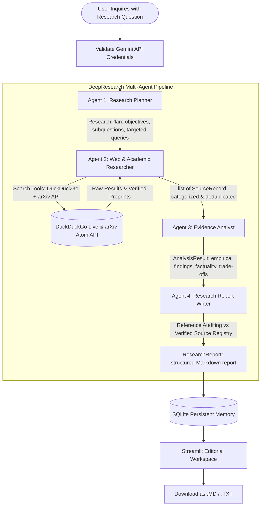

# DeepResearch AI

**Tagline:** *From complex questions to evidence-based insights.*  
**Specialization:** AI Systems & Software Engineering Research

DeepResearch AI is an autonomous, multi-agent research platform that transforms complex technical questions into structured, evidence-based reports. Built with **PydanticAI**, **Google Gemini**, **DuckDuckGo Search**, the public **arXiv API**, **Pydantic**, and **Streamlit**, it plans investigations, gathers evidence across academic preprints and official technical sources, evaluates empirical findings, and produces publication-grade reports with audited citations.

---

## 1. Domain Specialization

DeepResearch AI is engineered specifically for deep-dive technical research across modern AI systems and software engineering:

- **Large Language Models (LLMs)**: Architecture paradigms, reasoning models, quantization, and serving infrastructure.
- **Retrieval-Augmented Generation (RAG)**: Chunking strategies, hybrid search, rerankers, and long-context trade-offs.
- **AI Agents & Multi-Agent Systems**: Task decomposition, agent communication protocols, supervisor architectures, and consensus mechanisms.
- **Agent Memory & Context Management**: Short-term vs. long-term persistence, episodic memory, and compaction techniques.
- **Tool Calling & Model Context Protocol (MCP)**: Standardized server-client tool schemas, execution sandboxing, and latency trade-offs.
- **AI Application Architecture**: Production pipelines, guardrails, fallback routing, and observability.
- **Backend & API Engineering**: Microservice patterns, async streaming, rate-limiting, and distributed systems.
- **Software Architecture & System Design**: Scalability bottlenecks, state synchronization, and fault-tolerant workflows.
- **Developer Tools & Frameworks**: LangGraph, PydanticAI, LlamaIndex, vLLM, and agent SDKs.
- **AI Evaluation, Reliability & Deployment**: Automated benchmarks, hallucination detection, unit testing for agents, and regression tracking.
- **AI Security & Responsible AI**: Prompt injection defenses, tool-execution vulnerabilities, unauthorized data exfiltration, and sandboxing.

Users can also formulate research inquiries on any technical topic. The system remains flexible and does not restrict queries to a predefined static list.

---

## 2. Multi-Agent Research Architecture



### The Four Specialized Roles

1. **Agent 1: Research Planner**
   - Deconstructs the research question into clear technical objectives, focused subquestions, and concrete search queries.
   - Outputs a validated `ResearchPlan` schema.
2. **Agent 2: Web & Academic Researcher**
   - Executes live searches across DuckDuckGo and the public arXiv Atom API.
   - Normalizes URLs, deduplicates sources, and categorizes findings into Academic Papers, Official Documentation, Engineering Articles, or General Web sources.
3. **Agent 3: Evidence Analyst**
   - Maps empirical findings to verified source URLs.
   - Evaluates technical rigor, separates sourced facts (`is_factual=True`) from architectural interpretations (`is_factual=False`), flags contradictions, and identifies remaining information gaps.
4. **Agent 4: Research Report Writer**
   - Synthesizes findings into an editorial, publication-grade report.
   - Audits all references against the verified source registry, preventing hallucinated citations.

---

## 3. Technology Stack

- **Agent Framework**: [PydanticAI](https://ai.pydantic.dev/) (orchestrated multi-agent pipeline with structured inputs and outputs)
- **Model Provider**: Google Gemini (`gemini-2.5-flash` by default via `google-genai`)
- **Live Search**: DuckDuckGo Search (`duckduckgo_search` / `ddgs`) — zero paid API key required
- **Academic Retrieval**: Official public arXiv Atom API (`export.arxiv.org/api/query`)
- **Data Validation**: [Pydantic v2](https://docs.pydantic.dev/) for strict schema contracts
- **UI Workspace**: [Streamlit](https://streamlit.io/) with a custom restrained, paper-toned editorial layout
- **Persistent Memory**: Local SQLite database (`research_agent.db`)
- **Testing**: [pytest](https://docs.pytest.org/) with comprehensive mocks and integration tests

---

## 4. Installation & Windows PowerShell Quickstart

### Prerequisites
- Python 3.11, 3.12, or 3.13 (Python 3.13 tested).
- Google Gemini API key ([free from Google AI Studio](https://aistudio.google.com/app/apikey)).

### Setup Steps

```powershell
# 1. Clone or navigate into the project directory
cd c:\Users\HP\reaserch-agent

# 2. Create and activate a virtual environment
python -m venv .venv
.\.venv\Scripts\Activate.ps1

# 3. Install dependencies
pip install -r requirements.txt

# 4. Configure environment variables
Copy-Item .env.example .env
```

Open `.env` in your text editor and set your Gemini API key:

```env
GEMINI_API_KEY=your_actual_gemini_api_key_here
GEMINI_MODEL=gemini-2.5-flash
DATABASE_PATH=research_agent.db
```

---

## 5. Running the Application Locally

Start the Streamlit editorial research workspace:

```powershell
.\.venv\Scripts\streamlit run app.py
```

The application will launch in your browser at `http://localhost:8501`.

---

## 6. Running Automated Tests

Run the test suite with pytest. All tests use mocks or local fixtures, requiring **zero paid API keys** and **no live internet access**:

```powershell
.\.venv\Scripts\python -m pytest -v
```

### Test Suite Structure
- `tests/test_schemas.py`: Schema validation, Pydantic constraints, and Markdown assembly.
- `tests/test_web_search.py`: URL normalization, DuckDuckGo mock searches, deduplication, and timeout recovery.
- `tests/test_specialization.py`: Source categorization (academic, docs, blogs, web), arXiv Atom XML parsing, and AI systems plan validation.
- `tests/test_memory.py`: SQLite session persistence, deserialization, keyword search, and preference preservation.
- `tests/test_workflow.py`: Missing API key detection, 4-stage execution order, citation auditing, and exception recovery.

---

## 7. Sample Research Questions

The workspace includes quick-select example questions focused on AI systems and software engineering:

1. *"How do multi-agent systems differ from single-agent architectures?"*
2. *"Compare RAG and long-context approaches for production AI systems."*
3. *"How does agent memory improve long-running AI workflows?"*
4. *"What are the trade-offs between LangGraph and other agent orchestration frameworks?"*
5. *"What are the main security risks when AI agents use external tools?"*

---

## 8. Source Quality & Citation Integrity

- **Categorized Evidence**: Sources are categorized into **Academic Papers & Preprints** (arXiv, OpenReview, IEEE, etc.), **Official Documentation** (GitHub, readthedocs, PEPs, RFCs), **Engineering Articles & Technical Blogs**, and **General Web**.
- **No Hallucinated Citations**: The citation auditing engine (`reconcile_and_audit_references`) reconciles every reference against real URLs retrieved during the search stage.
- **Graceful Error Handling**: If DuckDuckGo or arXiv is unreachable, the system leverages an open encyclopedia fallback or logs transparent gaps rather than inventing fake data.

---

## 9. Current Limitations & Considerations

- **Snippet-Length Analysis**: The web search agent inspects search snippets and paper abstracts rather than executing full browser scraping.
- **Rate-Limiting**: Free search endpoints may occasionally throttle rapid bursts of queries; the workflow includes automated retries and fallback endpoints to maintain reliability.
- **Deployment**: For multi-user cloud deployment, replace local SQLite with PostgreSQL and configure secure secrets management.
