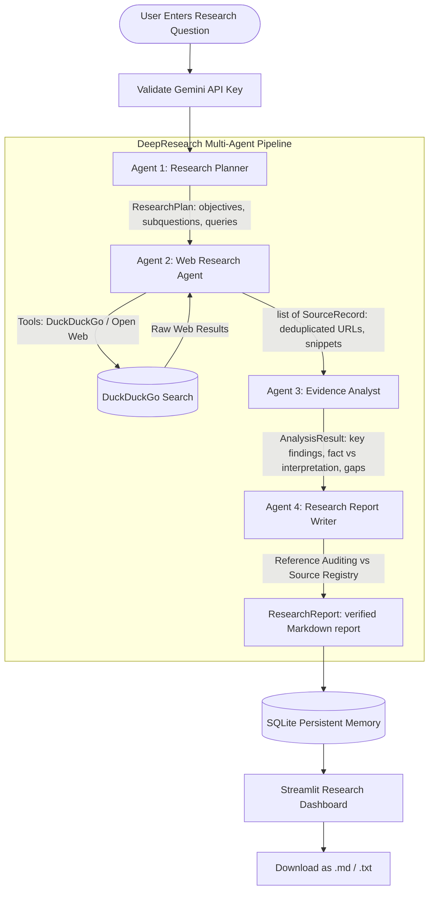

# DeepResearch AI — Multi-Agent Research Assistant

**DeepResearch AI** is a complete, beginner-friendly multi-agent research assistant built with **PydanticAI**, **Google Gemini**, **DuckDuckGo Search**, **Pydantic**, and **Streamlit**.

It takes a complex research question, coordinates four specialized AI agents to plan, search, analyze, and write a structured, citation-verified report, and persists all research sessions in a local **SQLite** database.

---

## 1. Problem Statement & Objectives

Single-prompt LLM outputs often suffer from:
1. **Hallucinated citations** and imaginary web links.
2. **Shallow synthesis** that confuses speculation with verified facts.
3. **Lack of transparency** regarding where evidence originated.
4. **No persistent memory** to compare or revisit prior research.

### Project Objectives
- **Multi-Agent Collaboration**: Split complex research into four distinct, specialized agents that genuinely exchange structured information.
- **Real Web Search Grounding**: Execute real web searches using DuckDuckGo (and open web fallbacks) without requiring paid search API keys.
- **Reference Auditing**: Audit every citation against a verified source registry to eliminate hallucinated links.
- **Persistent Memory**: Store full research sessions in local SQLite for historical retrieval, keyword search, and reloading.
- **Interactive UI**: Provide an intuitive Streamlit dashboard with real-time stage progress, evidence inspection, and report downloads (`.md` and `.txt`).

---

## 2. Architecture & Workflow



---

## 3. Why Multiple Agents?

Instead of relying on a monolithic prompt to do everything at once, dividing responsibilities among specialized agents yields higher accuracy, verifiability, and control:

| Agent | Responsibility | Input | Structured Output |
| :--- | :--- | :--- | :--- |
| **Agent 1: Research Planner** | Analyzes the core objective, generates 3–6 subquestions, and formulates targeted search queries. | User Question & Depth | `ResearchPlan` |
| **Agent 2: Web Research Agent** | Executes DuckDuckGo queries, normalizes URLs, deduplicates, and collects real titles and snippets. | `ResearchPlan` | `list[SourceRecord]` |
| **Agent 3: Evidence Analyst** | Maps findings to supporting source URLs, identifies contradictions, evaluates weak sources, and separates facts from interpretation. | `ResearchPlan` + `list[SourceRecord]` | `AnalysisResult` |
| **Agent 4: Research Report Writer** | Compiles a publication-grade report with executive summary, methodology, and verified numbered references. | Full Context + Source Registry | `ResearchReport` |

### How Information Moves Between Agents
Agents do **not** run in isolation. Each agent consumes the validated structured output of the preceding agent:
1. The **Planner**'s queries directly drive the **Researcher**'s DuckDuckGo tool execution.
2. The **Researcher**'s verified source records are fed directly into the **Analyst** along with the plan.
3. The **Analyst**'s empirical findings (`is_factual=True/False`) guide the **Writer** to prevent unsupported speculation.
4. The **Writer** checks all citations against the real **Source Registry**, ensuring that every `[1]`, `[2]` link points to a real URL retrieved by Agent 2.

---

## 4. Key Engineering Concepts

### Tool Calling & Search Integration
- **DuckDuckGo Search (`duckduckgo_search` / `ddgs`)**: Operates without requiring an external paid API key or separate sign-up.
- **Normalization & Deduplication**: URLs are normalized (stripping trailing slashes, fragments, and tracking query params) to eliminate redundant sources.
- **Resilient Fallback**: If DuckDuckGo hits network rate limits or timeouts, an automated open encyclopedia fallback retrieves real verified articles and extracts without fabricating data.

### Pydantic Structured Output Validation
- Built with `pydantic>=2.10` and `pydantic-ai`.
- Strict typing and constraints (e.g. `min_length=2` for subquestions, URL validation via `SourceRecord`).
- Enforces predictable data exchange between stages.

### Persistent SQLite Memory
- Stored locally in `research_agent.db` without needing an external database server.
- Stores: session ID, ISO timestamp, question, depth, plan JSON, source records JSON, analysis JSON, report JSON, and full Markdown.
- **Transparent Keyword Search**: Searches historical questions and reports via SQL `LIKE` queries without making false claims of vector embeddings.
- **User Preferences**: Stored in a separate `user_preferences` table, so clearing research history preserves configuration settings.

---

## 5. Installation & Setup

### Prerequisites
- Python 3.11 or newer (Python 3.13 tested).
- Google Gemini API key ([free from Google AI Studio](https://aistudio.google.com/app/apikey)).

### Windows PowerShell Quickstart

```powershell
# 1. Clone or navigate to the repository
cd c:\Users\HP\reaserch-agent

# 2. (Optional) Create and activate a virtual environment
python -m venv venv
.\venv\Scripts\Activate.ps1

# 3. Install required dependencies
pip install -r requirements.txt

# 4. Configure your .env file
Copy-Item .env.example .env
# Edit .env and enter your Gemini API key:
# GEMINI_API_KEY=your_actual_key_here
```

---

## 6. Running the Application

Launch the Streamlit web dashboard:

```powershell
streamlit run app.py
```

The application will open automatically in your browser at `http://localhost:8501`.

---

## 7. Running the Automated Tests

The test suite runs with full mocks, requiring **no paid API keys** and **no live internet connection**:

```powershell
python -m pytest -v
```

### Test Coverage Highlights
- `test_schemas.py`: Validates Pydantic constraints, URL validation, and Markdown assembly.
- `test_memory.py`: Verifies SQLite session upserts, deserialization, keyword search, and clearing history.
- `test_web_search.py`: Verifies URL normalization, deduplication, empty results, and network timeout handling.
- `test_workflow.py`: Validates missing API key error handling, stage execution order, citation auditing against the source registry, and error recovery.

---

## 8. Sample Research Questions

Try entering these questions in the dashboard:
1. *"How are AI agents changing software engineering in 2026?"*
2. *"What are the major breakthrough developments in quantum computing in 2026?"*
3. *"What is the current state and outlook for commercial nuclear fusion power?"*
4. *"How is autonomous robotic surgery regulated by global health authorities?"*

---

## 9. Student Presentation & Defense Guide

When presenting this project to your instructor or evaluators, highlight these core pillars:

1. **Multi-Agent Systems**:
   - *Defense Point*: Emphasize that this is not a single generic prompt. The pipeline uses four distinct agents with separation of concerns: decomposition (Planner), perception (Researcher), critical evaluation (Analyst), and communication (Writer).
2. **Tool Calling & Real World Grounding**:
   - *Defense Point*: The system executes real web search queries via DuckDuckGo. No URLs are fabricated. If search is blocked or rate-limited, the system transparently logs the constraint rather than inventing fake links.
3. **Structured Outputs with PydanticAI**:
   - *Defense Point*: PydanticAI forces the LLM to output validated Pydantic schemas at each stage. If a field fails validation, PydanticAI catches and handles it before passing data downstream.
4. **Citation Auditing**:
   - *Defense Point*: The `reconcile_and_audit_references` mechanism cross-references every report citation against the source registry collected by Agent 2, completely preventing LLM hallucination of sources.
5. **Persistent Memory**:
   - *Defense Point*: SQLite provides persistence across sessions. Prior research can be re-opened, searched via keyword matching, or used as the basis for new questions.

---

## 10. Known Limitations & Future Improvements

- **Snippet Limitations**: Web search results provide snippets rather than full-length web scraping. Deep scraping with HTML parsing could be added in future iterations.
- **Rate Limits**: Free search engines like DuckDuckGo can throttle frequent programmatic queries; our resilient open web fallback mitigates this.
- **Future Enhancements**: Add PDF export support, multi-turn follow-up research questions, and export to Zotero/BibTeX.
